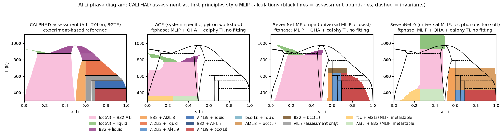

# PhaseDiagram / ftphase

Design documents, worked examples and a Python package for computing finite-temperature binary phase diagrams (solid
solutions, line compounds, ordered phases with a composition range, liquid) from MLIPs (machine-learning interatomic
potentials) + phonon QHA + calphy thermodynamic integration. The working language of the documents is Japanese.

The Al–Li phase diagram. Left: the experiment-based CALPHAD assessment (AlLi-20Lon, SGTE, via ORCHID-Diagrams). The three
panels on the right: T–x diagrams computed from MLIPs with ftphase (a system-specific ACE, and the universal MLIPs
SevenNet-MF-ompa and SevenNet-0; solids by QHA, liquid by calphy thermodynamic integration, no fit to interpolation functions.
Black lines are the phase boundaries of the assessment, dashed lines its invariant reactions). For x_Li > 0.5 only the solids
were computed (Al₂Li₃, Al₄Li₉, bcc Li; no liquid).
All 13 MLIPs side by side: [`docs/img/alli_overlay_13mlip.png`](docs/img/alli_overlay_13mlip.png).
The figures are drawn by `ftphase/examples/orchid_calphad/hero_alli.py` / `sgte_diagrams.py`; the numbers for each MLIP and
the comparison with ORCHID are in section 4 of the
[project status page](https://claude.ai/artifact/NZEKsthcgzmVw4QppWjifk) (Japanese / English / Indonesian).

- `ftphase/` — the package of this project (stages 01–07, AiiDA WorkChain, examples). **MIT License** (`LICENSE`).
  Usage: `ftphase/README.md`; design and verification results: `docs/ftphase.html`.
- `docs/`, `skills/` — design documents, decision rules and reference notes (MIT).
- `calphy-examples/` — a copy of the upstream calphy (ICAMS) `examples/`, converted to Slurm and executed.
  It is subject to calphy's **Academic Software Licence v1.0 (non-commercial)**; the changes are listed in the README of
  that folder.
- `pycalphad-examples/` — an executed copy of the upstream `examples/` of pycalphad 0.11.2 (pycalphad's MIT License).
- `pyiron-examples/` — run records of the pyiron potentials-workshop-2022 tutorial and of the Al–Li example of
  Menon et al. 2024. The upstream potential files (EAM / ACE / HDNNP) are not included in this repository; obtain them from
  the sources given in each README and put them in `resources/lammps/potentials/`.
- `env/` — how to recreate the conda environments and the LAMMPS builds (the environments themselves are not committed).
- Not included: `資料/` (source PDFs), `potentials/` (third-party potentials), `papers/`, `data/orchid-*` (download again
  from Zenodo).

`CLAUDE.md` is the working memo for Claude Code; it also serves as the record of the environments, the compute hosts and the
calculations that have been run.
